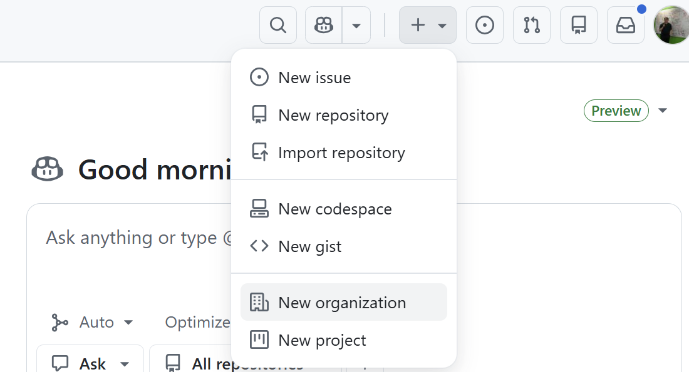

# GitHub에 Organization 만들기   

## GitHub 회원가입
https://github.com에 접속하여 회원가입을 합니다.    
그리고 로그인합니다.   

## 나만의 Organization 만들기    
GitHub의 저장소(Repository)를 목적별로 그룹핑한 것이 Organization이에요.    
아래 순서로 만들어요.    

- 새로운 Organization 만들기 시작    
    

- 플랜 선택: Free 카드에 있는 'Create a free organization' 클릭    
- Organization 정보 입력 
  - Organization name: 전세계적으로 중복되지 않는 본인의 Organization이름을 입력
  - Contact email: 본인 email 입력
  - personal과 business는 적절히 입력. 처음 시작시에는 personal account 선택

- 'Next' 클릭하여 생성 완료    

